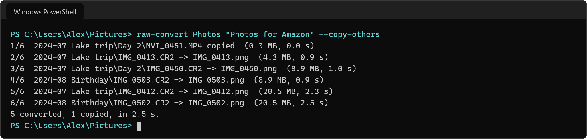
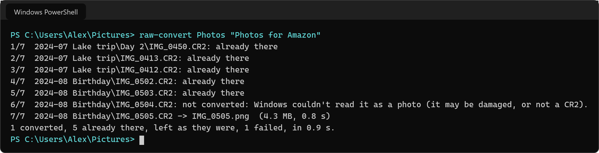

<p align="center">
  <a href="https://strongthium.com" title="Strongthium Labs"></a>
</p>

# raw-convert

[](https://github.com/strongthium/raw-convert/actions/workflows/release.yml)
[](https://github.com/strongthium/raw-convert/releases/latest)
[](LICENSE)

`raw-convert` is a Windows command-line tool that batch converts Canon CR2 RAW photos to PNG or TIFF, losslessly and at
full size. Give it a folder and it converts every CR2 in it and in the folders inside it, into the same folders under
a new one, with the date taken, camera, lens, exposure and GPS of each photo. PNG and TIFF are both formats Amazon
Photos takes, and both keep every pixel: nothing is lost to JPEG compression, and nothing is resized.

It runs on Windows 10 and 11, is one file of about 300 KB with nothing to install, and sends nothing anywhere unless
you ask it to look for a newer version.



**[The manual](docs/README.md)** goes through every command, with what each part does and how to use it.

## A tour

The pictures are of a made-up folder of photos: sample CR2 files from [raw.pixls.us](https://raw.pixls.us), which
are in the public domain (CC0), under made-up names.

### Converting a folder

```
raw-convert Photos "Photos for Amazon"
```

Every `.CR2` under `Photos` becomes a `.png` at the same place under `Photos for Amazon`, which is made if it isn't
there: `Photos\2024-07 Lake trip\IMG_0412.CR2` becomes `Photos for Amazon\2024-07 Lake trip\IMG_0412.png`. The photos
in `Photos` aren't changed. Four photos are converted at once (fewer on a PC with fewer than eight processors), and a
20-megapixel photo takes about two seconds. Each line says which file, how big it came out and how long it took; they
finish in their own order.

`--copy-others` copies the files that aren't CR2 (the camera's videos, JPEGs, anything else) into the output folder
as well, so that it holds the whole of the folder, ready to upload.

### Running it again



A photo already in the output folder is left as it is, so running it again after adding photos, or after stopping it
with **Ctrl+C**, converts only what's left. `--overwrite` converts everything again. A file that can't be read (here
one that's damaged) is said and skipped, and the rest go on; the exit code is then 1. A photo is written beside
its final name, as `.png.partial`, and renamed once it's whole, so a file stopped half way through is never taken for
a finished one.

### PNG or TIFF

| | PNG (the default) | TIFF (`--format tiff`) |
|---|---|---|
| **Compression** | deflate, with each row filtered the best of PNG's five ways | deflate, after horizontal differencing ("Adobe Deflate", predictor 2) |
| **Size** of a 20-megapixel Canon EOS 6D photo | 20.5 MB | 22.4 MB |
| **Opens in** | everything: browsers, Amazon Photos' viewer, every phone | Photoshop, Lightroom, Windows Photos; some web viewers won't show it |
| **The photo's details** | the whole Exif and GPS in an `eXIf` chunk, and the date taken, camera and lens again in XMP, which is where Windows looks in a PNG | the whole Exif and GPS, as in the camera's own file; every program reads them |

Both are lossless: the file holds exactly the picture Windows developed from the RAW, pixel for pixel. The tests read
every file written back with Windows' own decoders, which aren't `raw-convert`'s, and compare each pixel.

### What's kept

| | |
|---|---|
| **Size** | the whole picture the RAW holds, never resized: 5496 × 3670 from a 6D, a little larger than the camera's own 5472 × 3648 JPEG. sRAW and mRAW photos stay at their smaller size |
| **Colour** | 8 bits a colour in sRGB, as Windows' Photos app shows the RAW. A CR2 holds 12 or 14 bits a colour, which no PNG or JPEG viewer shows; editing the RAW itself is still the way to use all of them |
| **Which way up** | a photo taken holding the camera upright is turned the right way, pixel by pixel, and marked as needing no turn, so it shows the right way up everywhere |
| **Details** | camera, lens, date and time taken, exposure, ISO, focal length, flash, GPS, artist and copyright. Canon's own maker note is left out: it only means something inside the CR2 |
| **File dates** | each file gets the CR2's created and modified dates, so a folder sorted by date sorts the same |

## Using it

Download the zip from [Releases](../../releases/latest), or take the `.exe` straight from [`public/`](public), which
always holds the latest build: `raw-convert.exe`, about 300 KB, for Windows 10 and 11 on x64 PCs. Put it in a folder
on your `PATH`, or run it from where it is. It runs on the [.NET 10 Runtime](https://dotnet.microsoft.com/download/dotnet/10.0)
installed on the PC, which Microsoft Update keeps patched.

The RAW photos are developed by Windows itself, with Microsoft's free
[Raw Image Extension](https://apps.microsoft.com/detail/9NCTDW2W1BH8), the same one that shows RAW photos in Explorer and
Photos. If it isn't installed, no photo converts and `raw-convert` says where to get it. The program is small because
it brings no decoder of its own: it reads the CR2's details and writes the PNG or TIFF itself, and leaves the RAW to
Windows.

```
raw-convert <input folder> <output folder> [options]

  --format png|tiff       PNG (the default) or TIFF; both are lossless and Amazon Photos takes both
  --overwrite             convert again what's already in the output folder (otherwise it's left as it is)
  --copy-others           copy the files that aren't CR2 (JPEGs, videos) into the output folder too
  --jobs <n>              how many photos to convert at once (default: half the processors, up to 4)
  --quiet                 say nothing but what goes wrong
  --about                 who makes this, and whether there's a newer version (GitHub is asked)
  --update                install the newer version, if there is one: it asks first, unless --yes is given
```

The output folder can be inside the input folder (`raw-convert Photos Photos\converted`): it isn't looked in for
photos. It can't be the input folder itself.

Each 20-megapixel photo being developed takes a few hundred megabytes of memory (one at a time, about 400 MB in all;
four at once, about 800 MB), which is why four at once is the most by default. `--jobs 1` keeps it light on a small
PC; more than 4 helps only on a PC with many processors and the memory for them.

Exit codes: 0 when everything was converted or was there already, 1 when a file failed or it was stopped, 2 when the
command line was wrong.

## About and updates

`raw-convert --about` says who makes it, with links to Strongthium, and asks GitHub whether there's a newer version.
`raw-convert --update` downloads the newer version if there is one, after asking (or straight away with `--yes`),
checks it against the release's `SHA256SUMS` and puts it in the place of the old one. If the program's folder can't be
changed without an administrator, it says so, with the release to download by hand. The checksums come with the
release, so they catch a damaged download, not a tampered release.

GitHub is asked only by `--about` and `--update`. `api.github.com` sees that the question came from your address, and
which program and version asked.

## Your data

Your photos never leave your PC, and nothing about them is sent anywhere or saved. `raw-convert` reads the input
folder and only ever writes inside the output folder.

## Building

You need Windows and the [.NET 10 SDK](https://dotnet.microsoft.com/download).

```
.\build.ps1                 # tests, then the program into public\  (or double-click build.cmd)
.\build.ps1 -Bump revision  # the same as a new version: 1.0.0.0 -> 1.0.0.1
```

`build.ps1` runs the tests (`-SkipTests` skips them), publishes the program, and replaces what's in
[`public/`](public) with it, its `SHA256SUMS` and the `VERSION` it was built as.

The version is in [`VERSION`](VERSION), `major.minor.patch.revision`, and every build reads it. `-Bump major|minor|patch|revision` or
`-Version 2.0.0.0` builds a new one, and `VERSION` is changed once that build has succeeded, so the version in the
repository is always the one in `public/`.

For working on it:

```
dotnet build
dotnet test
dotnet run --project src/RawConvert -- D:\Photos D:\Converted
```

| Folder | What's in it |
|---|---|
| [`src/RawConvert`](src/RawConvert) | the program: the batch, decoding through Windows' imaging (WIC), the CR2's TIFF directories read and written again, turning by the orientation tag, and the PNG and TIFF writers |
| [`tests/RawConvert.Tests`](tests/RawConvert.Tests) | tests of all of it, on pictures and CR2 files made up in the tests, and what's written read back with Windows' own decoders |
| [`public`](public) | the latest build, made by `build.ps1` |
| [`build.ps1`](build.ps1), [`build.cmd`](build.cmd), [`VERSION`](VERSION) | the builder, and the version it builds |

`master` holds the source. A push to `deploy` (a merge into it counts) runs
[`.github/workflows/release.yml`](.github/workflows/release.yml), which:

1. runs the tests on Windows;
2. builds the x64 program, one `.exe`;
3. publishes release `v<VERSION>` with its zip and `SHA256SUMS`. A version is released once: to release
   again, raise it first (`build.ps1 -Bump revision`).

## Strongthium open-source tools

The other free, MIT-licensed tools from Strongthium Labs, each built by GitHub Actions from its source at [github.com/strongthium](https://github.com/strongthium):

<table>
  <tr>
    <td width="64" align="center" valign="top">
      <a href="https://github.com/strongthium/emudhra-security-patch"><picture><source media="(prefers-color-scheme: dark)" srcset="https://raw.githubusercontent.com/strongthium/.github/main/profile/icons/dark/certificate.svg"></picture></a>
    </td>
    <td valign="top">
      <a href="https://github.com/strongthium/emudhra-security-patch"><b>Strongthium eMudhra Security Patch</b></a><br>
      <sub><b>Certificate trust-store patch for Windows and Linux.</b> Finds eMudhra's G3B and G3C intermediate CAs, and the roots above them, and distrusts them.</sub>
    </td>
    <td width="64" align="center" valign="top">
      <a href="https://github.com/strongthium/folder-size"><picture><source media="(prefers-color-scheme: dark)" srcset="https://raw.githubusercontent.com/strongthium/.github/main/profile/icons/dark/treemap.svg"></picture></a>
    </td>
    <td valign="top">
      <a href="https://github.com/strongthium/folder-size"><b>Strongthium Folder Size</b></a><br>
      <sub><b>Fast disk space analyzer for Windows.</b> Every folder added up, largest first, as a tree, a treemap, the largest files and the space by type.</sub>
    </td>
  </tr>
  <tr>
    <td width="64" align="center" valign="top">
      <a href="https://github.com/strongthium/health-reminder"><picture><source media="(prefers-color-scheme: dark)" srcset="https://raw.githubusercontent.com/strongthium/.github/main/profile/icons/dark/pill.svg"></picture></a>
    </td>
    <td valign="top">
      <a href="https://github.com/strongthium/health-reminder"><b>Strongthium Health Reminder</b></a><br>
      <sub><b>Medication reminder, pill identifier and meal planner for Windows.</b> Insistent reminders of pills, meals and water, with a picture of the very pill to take.</sub>
    </td>
    <td width="64" align="center" valign="top">
      <a href="https://github.com/strongthium/host-dossier"><picture><source media="(prefers-color-scheme: dark)" srcset="https://raw.githubusercontent.com/strongthium/.github/main/profile/icons/dark/dossier.svg"></picture></a>
    </td>
    <td valign="top">
      <a href="https://github.com/strongthium/host-dossier"><b>Strongthium Host Dossier</b></a><br>
      <sub><b>Domain and IP lookup tool for Windows and Linux.</b> WHOIS, DNS, TLS, open ports and every mail record of a domain or an address, in one report.</sub>
    </td>
  </tr>
  <tr>
    <td width="64" align="center" valign="top">
      <a href="https://github.com/strongthium/outbound-watch"><picture><source media="(prefers-color-scheme: dark)" srcset="https://raw.githubusercontent.com/strongthium/.github/main/profile/icons/dark/outbound.svg"></picture></a>
    </td>
    <td valign="top">
      <a href="https://github.com/strongthium/outbound-watch"><b>Strongthium Outbound Watch</b></a><br>
      <sub><b>Outbound connection monitor for Windows.</b> Where every program on your PC connects to, live and as history, and a warning when one goes somewhere new.</sub>
    </td>
    <td width="64" align="center" valign="top">
      <a href="https://github.com/strongthium/video-dispatch"><picture><source media="(prefers-color-scheme: dark)" srcset="https://raw.githubusercontent.com/strongthium/.github/main/profile/icons/dark/video.svg"></picture></a>
    </td>
    <td valign="top">
      <a href="https://github.com/strongthium/video-dispatch"><b>Strongthium Video Dispatch</b></a><br>
      <sub><b>TikTok and YouTube uploader and video editor for Windows.</b> One video queued to TikTok, YouTube and Shorts, cut and trimmed with Windows' own tools.</sub>
    </td>
  </tr>
  <tr>
    <td width="64" align="center" valign="top">
      <a href="https://github.com/strongthium/webdav-server"><picture><source media="(prefers-color-scheme: dark)" srcset="https://raw.githubusercontent.com/strongthium/.github/main/profile/icons/dark/webdav.svg"></picture></a>
    </td>
    <td valign="top">
      <a href="https://github.com/strongthium/webdav-server"><b>Strongthium WebDAV Server</b></a><br>
      <sub><b>Self-hosted WebDAV server for Linux and Windows.</b> Files by user or by path, Nextcloud-compatible, with bans and IP, ASN and country whitelists.</sub>
    </td>
    <td></td>
    <td></td>
  </tr>
</table>

## More from Strongthium

Strongthium Labs also makes software for running your own servers and Windows PCs, for talking to your customers, and for billing your hours, at [strongthium.com](https://strongthium.com):

<table>
  <tr>
    <td width="64" align="center" valign="top">
      <a href="https://strongthium.com/linux-server-firewall"><picture><source media="(prefers-color-scheme: dark)" srcset="https://raw.githubusercontent.com/strongthium/.github/main/profile/icons/dark/guard.svg"></picture></a>
    </td>
    <td valign="top">
      <a href="https://strongthium.com/linux-server-firewall"><b>Strongthium Guard</b></a><br>
      <sub><b>Linux server firewall.</b> Locks down your Linux servers, reads their logs and shuts out whoever attacks them, within seconds.</sub>
    </td>
    <td width="64" align="center" valign="top">
      <a href="https://strongthium.com/self-hosted-mail-server"><picture><source media="(prefers-color-scheme: dark)" srcset="https://raw.githubusercontent.com/strongthium/.github/main/profile/icons/dark/mail.svg"></picture></a>
    </td>
    <td valign="top">
      <a href="https://strongthium.com/self-hosted-mail-server"><b>Strongthium Mail</b></a><br>
      <sub><b>Self-hosted mail server for Linux and Windows.</b> Receives, checks and sends your mail, and tells you exactly why it refused what it refused.</sub>
    </td>
  </tr>
  <tr>
    <td width="64" align="center" valign="top">
      <a href="https://strongthium.com/self-hosted-live-chat"><picture><source media="(prefers-color-scheme: dark)" srcset="https://raw.githubusercontent.com/strongthium/.github/main/profile/icons/dark/chat.svg"></picture></a>
    </td>
    <td valign="top">
      <a href="https://strongthium.com/self-hosted-live-chat"><b>Strongthium Chat</b></a><br>
      <sub><b>Self-hosted live chat for Linux and Windows.</b> A chat on your websites and text messages in one inbox, answered from Windows or a browser.</sub>
    </td>
    <td width="64" align="center" valign="top">
      <a href="https://strongthium.com/windows-ssh-client"><picture><source media="(prefers-color-scheme: dark)" srcset="https://raw.githubusercontent.com/strongthium/.github/main/profile/icons/dark/remote.svg"></picture></a>
    </td>
    <td valign="top">
      <a href="https://strongthium.com/windows-ssh-client"><b>Strongthium Remote</b></a><br>
      <sub><b>Windows SSH client.</b> SSH terminal, file manager, editor, server task manager, database client and remote desktop in tabs, in one program.</sub>
    </td>
  </tr>
  <tr>
    <td width="64" align="center" valign="top">
      <a href="https://strongthium.com/twilio-sms-desktop-app"><picture><source media="(prefers-color-scheme: dark)" srcset="https://raw.githubusercontent.com/strongthium/.github/main/profile/icons/dark/sms.svg"></picture></a>
    </td>
    <td valign="top">
      <a href="https://strongthium.com/twilio-sms-desktop-app"><b>Strongthium SMS</b></a><br>
      <sub><b>Twilio text messages for Windows.</b> Sends and receives your own Twilio account's texts from Windows, and blocks senders by number or by country.</sub>
    </td>
    <td width="64" align="center" valign="top">
      <a href="https://strongthium.com/windows-registry-editor"><picture><source media="(prefers-color-scheme: dark)" srcset="https://raw.githubusercontent.com/strongthium/.github/main/profile/icons/dark/registry.svg"></picture></a>
    </td>
    <td valign="top">
      <a href="https://strongthium.com/windows-registry-editor"><b>Strongthium Registry</b></a><br>
      <sub><b>Windows registry editor.</b> Shows what each key and value means, finds any key in seconds, and backs up every change before it's made.</sub>
    </td>
  </tr>
  <tr>
    <td width="64" align="center" valign="top">
      <a href="https://strongthium.com/video-conferencing-dial-up-modem"><picture><source media="(prefers-color-scheme: dark)" srcset="https://raw.githubusercontent.com/strongthium/.github/main/profile/icons/dark/convey.svg"></picture></a>
    </td>
    <td valign="top">
      <a href="https://strongthium.com/video-conferencing-dial-up-modem"><b>Strongthium Convey</b></a><br>
      <sub><b>Video conferencing for Windows.</b> Video, sound and text chat between Windows PCs, over the Internet, a dial-up modem or a cable.</sub>
    </td>
    <td></td>
    <td></td>
  </tr>
</table>

## License

MIT, see [LICENSE](LICENSE).
