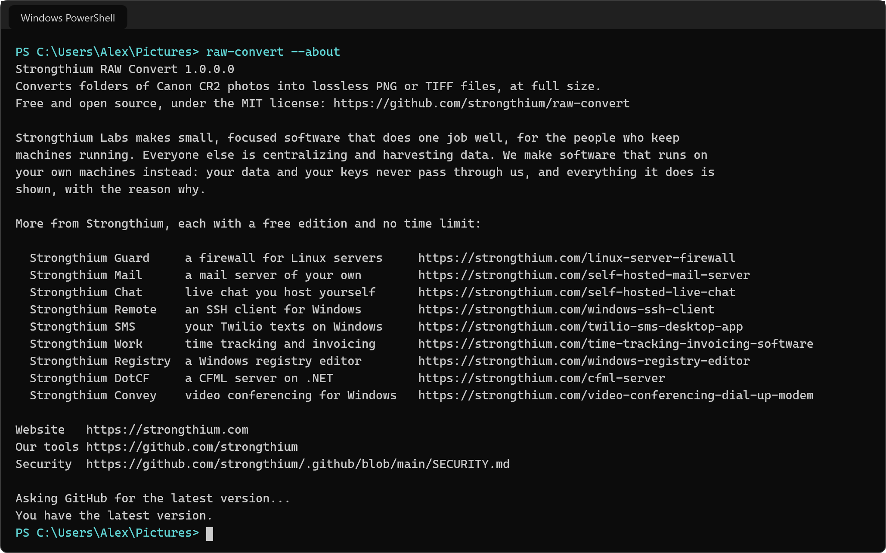

<p align="center">
  <a href="https://strongthium.com" title="Strongthium Labs"></a>
</p>

[raw-convert](../README.md) › [Manual](README.md) › `--about` and `--update`

# `--about` and `--update`



```
raw-convert --about
raw-convert --update [--yes]
```

Both ask GitHub for the latest release of `raw-convert`. They're the only times it goes on the Internet. Folders given
with them are passed over: nothing is converted. Given both, `--update` is the one done.

## `--about`

| | |
|---|---|
| **Strongthium RAW Convert** and the version | the version that's running, in four numbers (`1.0.0.0`) |
| The next two lines | what it does, and that it's free and open source under the MIT license, with its page on GitHub |
| **Strongthium Labs makes...** | who makes it |
| **More from Strongthium** | Strongthium's other programs, each with its page on strongthium.com |
| **Website**, **Our tools**, **Security** | strongthium.com, Strongthium's tools on GitHub, and how to report a security problem |
| **Asking GitHub for the latest version...** | then the answer: see below |

## The answer

| | |
|---|---|
| **You have the latest version.** | nothing more to do |
| **This is newer than the latest release, ...** | a build newer than any release, such as one built from the source |
| **Version ... is out. You have .... What's new: ...** | with the link to the release's page. Then it asks **Update to ... now? It's checked against the release's checksums first. [y/N]**: an answer that starts with a lower-case **y** updates it, anything else leaves it as it is |

When nobody is there to answer (its input comes from a file or another program), it doesn't ask: `--about` says the
version is out and stops there, and `--update` says **--update asks before it changes anything; pass --yes when nobody
is there to answer.** and changes nothing.

`--yes` (or `-y`) skips the question and updates straight away, with `--update` and with `--about` alike.

## How it updates

1. It downloads the release's `SHA256SUMS`, then its zip, `raw-convert-<version>-win-x64-needs-dotnet.zip`, into a
   new folder in your temporary folder (`%TEMP%`). Only files of `raw-convert`'s own releases on GitHub are taken.
2. It checks the zip against the checksum `SHA256SUMS` gives it. If they differ, nothing is changed.
3. It takes `raw-convert.exe`, and nothing else, out of the zip, as `raw-convert.exe.new` beside the running one.
4. The running `raw-convert.exe` is renamed `raw-convert.exe.old` (Windows lets a running program be renamed, not
   overwritten), and the new one takes its name. If that fails, the old one gets its name back.
5. It says **Updated to ...**. The temporary folder is deleted, and `raw-convert.exe.old` is deleted the next time
   `raw-convert` starts.

The checksums come with the release, so they catch a damaged download, not a tampered release.

## When it can't

Each of these is followed by **The releases are at https://github.com/strongthium/raw-convert/releases/latest**, to
download it by hand, and the exit code is 1.

| | |
|---|---|
| **This program can't be replaced from here: ... needs an administrator to change it.** | `raw-convert.exe` is in a folder, such as `C:\Program Files`, that only an administrator can change. Run `--update` from a prompt run as administrator, or replace the file by hand |
| **GitHub took too long to answer.** | no answer to the question, or to the download of `SHA256SUMS`, within 20 seconds. The download of the zip itself takes as long as it takes |
| **GitHub has had too many questions from this address for now. Try again in an hour.** | GitHub limits how often one address can ask without signing in |
| **GitHub's answer couldn't be read.** | the answer wasn't what a release looks like |
| **GitHub's latest release is called "...", which isn't a version.** | the release's tag isn't a version of four numbers |
| **The release has no ....** / **The release has no SHA256SUMS to check it against.** | the release is missing the zip or its checksums |
| **SHA256SUMS doesn't list ....** | the checksums don't include the zip |
| **The download of ... doesn't match the release's SHA256SUMS, so nothing was changed.** | the download was damaged, or the release's files don't go together |
| **The download doesn't hold raw-convert.exe.** | the zip has no program in it |
| anything else | Windows' or .NET's own message, such as when there's no Internet connection |

## What GitHub sees

`api.github.com` sees that the question came from your address, and which program and version asked
(`raw-convert/1.0.0.0`). Nothing else is sent: not your photos, folders or anything about them.

← [Installing](installing.md) · [Contents](README.md) · [Converting a folder](converting.md) →

<!-- strongthium-links -->

---

<p align="center"><sub>
<b>Strongthium open-source tools:</b> <a href="https://github.com/strongthium/emudhra-security-patch">eMudhra Security Patch</a> · <a href="https://github.com/strongthium/folder-size">Folder Size</a> · <a href="https://github.com/strongthium/health-reminder">Health Reminder</a> · <a href="https://github.com/strongthium/host-dossier">Host Dossier</a> · <a href="https://github.com/strongthium/outbound-watch">Outbound Watch</a> · <b>RAW Convert</b> · <a href="https://github.com/strongthium/video-dispatch">Video Dispatch</a> · <a href="https://github.com/strongthium/webdav-server">WebDAV Server</a><br>
<b>More from Strongthium:</b> <a href="https://strongthium.com/linux-server-firewall">Guard</a> · <a href="https://strongthium.com/self-hosted-mail-server">Mail</a> · <a href="https://strongthium.com/self-hosted-live-chat">Chat</a> · <a href="https://strongthium.com/windows-ssh-client">Remote</a> · <a href="https://strongthium.com/twilio-sms-desktop-app">SMS</a> · <a href="https://strongthium.com/time-tracking-invoicing-software">Work</a> · <a href="https://strongthium.com/windows-registry-editor">Registry</a> · <a href="https://strongthium.com/cfml-server">DotCF</a> · <a href="https://strongthium.com/video-conferencing-dial-up-modem">Convey</a><br>
<a href="https://strongthium.com">Strongthium Labs</a> · Take back control of your internet.
</sub></p>
