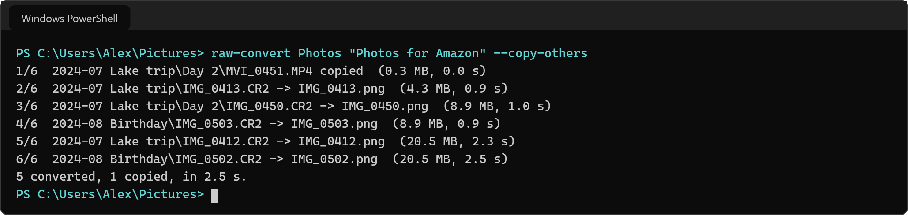

<p align="center">
  <a href="https://strongthium.com" title="Strongthium Labs"></a>
</p>

[raw-convert](../README.md) › [Manual](README.md) › Converting a folder

# Converting a folder



```
raw-convert <input folder> <output folder> [options]
```

```
raw-convert Photos "Photos for Amazon" --copy-others
```

Every `.CR2` under `Photos` becomes a `.png` at the same place under `Photos for Amazon`:
`Photos\2024-07 Lake trip\IMG_0412.CR2` becomes `Photos for Amazon\2024-07 Lake trip\IMG_0412.png`. The photos in
`Photos` aren't changed. The pictures are of a made-up folder of photos.

## Which files

| | |
|---|---|
| **Photos** | every file whose name ends in `.CR2`, in capitals or not, in the input folder and in every folder inside it, however deep |
| **Other files** | left where they are, unless `--copy-others` is given (below) |
| **Hidden and system files and folders** | passed over |
| **Folders it isn't allowed into** | passed over without a word |

## Where they go

Each photo goes to the same place under the output folder as it was under the input folder, with `.png` (or `.tif`,
with `--format tiff`) in place of `.CR2`. The output folder, and the folders inside it, are made as they're needed.

Folders that aren't full paths are taken from the folder you're in. A name with spaces goes in quotes:
`"Photos for Amazon"`.

The output folder can be inside the input folder (`raw-convert Photos Photos\converted`): it isn't looked in for
photos. It can't be the input folder itself, which is refused (see [Messages and exit codes](messages.md)).

## As it goes

Each line is a file done:

```
3/6  2024-07 Lake trip\Day 2\IMG_0450.CR2 -> IMG_0450.png  (8.9 MB, 1.0 s)
```

| | |
|---|---|
| **3/6** | the third file done of the 6 there are to do. The files are started folder by folder, in order of name, but finish in their own order: a small photo started later is often done first |
| **2024-07 Lake trip\Day 2\IMG_0450.CR2** | the photo, from the input folder |
| **-> IMG_0450.png** | the file it became, in the same folder under the output folder |
| **(8.9 MB, 1.0 s)** | its size, in megabytes of a million bytes, and how long it took |

When they're all done, one line adds it up:

```
5 converted, 1 copied, in 2.5 s.
```

A photo already in the output folder, or one that can't be read, has its own line, and the last line says how many
there were: see [Running it again](running-again.md), and every line it can print in
[Messages and exit codes](messages.md). `--quiet` leaves out all but what goes wrong.

## Several at once

Several photos are converted at once, and the turning, compressing and writing of each one is shared out among all
of the processors. How many at once is half the PC's processors by default, up to 4 (on a PC with 8 or more, 4):
`raw-convert --help` says how many on yours. `--jobs <n>` sets it, from 1 to 64.

A 20-megapixel photo takes a few hundred megabytes of memory while it's developed, so each one more at once takes
that much more. `--jobs 1` keeps it light on a small PC; more than 4 helps only on a PC with many processors and the
memory for them.

## The other files: `--copy-others`

```
raw-convert Photos "Photos for Amazon" --copy-others
```

Every file that isn't a CR2 (the camera's videos, JPEGs, anything else) is copied to the same place under the output
folder, as it is, so that the output folder holds the whole of the input folder, ready to upload. Each is a line of its
own:

```
1/6  2024-07 Lake trip\Day 2\MVI_0451.MP4 copied  (0.3 MB, 0.0 s)
```

and the last line says how many were copied. A copy gets the created and modified dates of the file it's a copy of,
as each photo gets its CR2's. Files ending in `.partial` aren't copied (see [Running it again](running-again.md)).

## When there's nothing to convert

```
There are no CR2 files in C:\Users\Alex\Pictures\Photos or the folders in it.
0 converted, in 0.0 s.
```

The exit code is still 0. With `--copy-others`, the other files are copied all the same.

← [`--about` and `--update`](about-and-updates.md) · [Contents](README.md) · [Running it again](running-again.md) →

<!-- strongthium-links -->

---

<p align="center"><sub>
<b>Strongthium open-source tools:</b> <a href="https://github.com/strongthium/emudhra-security-patch">eMudhra Security Patch</a> · <a href="https://github.com/strongthium/folder-size">Folder Size</a> · <a href="https://github.com/strongthium/health-reminder">Health Reminder</a> · <a href="https://github.com/strongthium/host-dossier">Host Dossier</a> · <a href="https://github.com/strongthium/outbound-watch">Outbound Watch</a> · <b>RAW Convert</b> · <a href="https://github.com/strongthium/video-dispatch">Video Dispatch</a> · <a href="https://github.com/strongthium/webdav-server">WebDAV Server</a><br>
<b>More from Strongthium:</b> <a href="https://strongthium.com/linux-server-firewall">Guard</a> · <a href="https://strongthium.com/self-hosted-mail-server">Mail</a> · <a href="https://strongthium.com/self-hosted-live-chat">Chat</a> · <a href="https://strongthium.com/windows-ssh-client">Remote</a> · <a href="https://strongthium.com/twilio-sms-desktop-app">SMS</a> · <a href="https://strongthium.com/time-tracking-invoicing-software">Work</a> · <a href="https://strongthium.com/windows-registry-editor">Registry</a> · <a href="https://strongthium.com/cfml-server">DotCF</a> · <a href="https://strongthium.com/video-conferencing-dial-up-modem">Convey</a><br>
<a href="https://strongthium.com">Strongthium Labs</a> · Take back control of your internet.
</sub></p>
