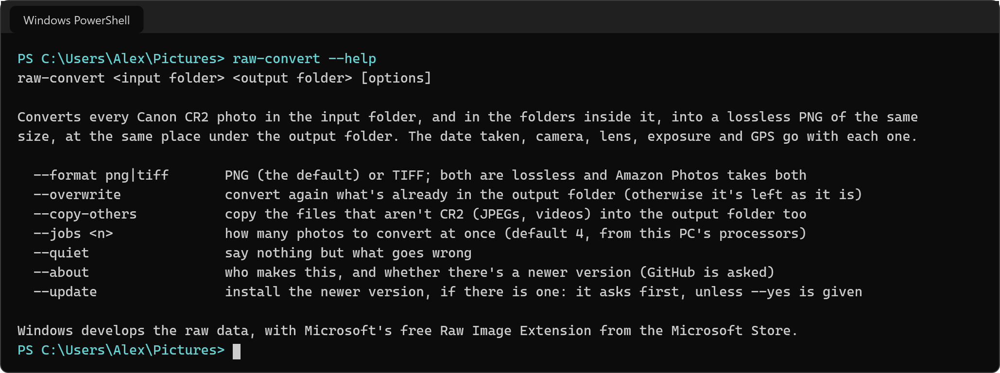

<p align="center">
  <a href="https://strongthium.com" title="Strongthium Labs"></a>
</p>

[raw-convert](../README.md) › [Manual](README.md) › Options

# Options



```
raw-convert <input folder> <output folder> [options]
raw-convert --about
raw-convert --update [--yes]
raw-convert --help
```

`raw-convert --help` lists them, as above. The number after **default** in `--jobs` is worked out from the PC it runs
on.

## The folders

| | |
|---|---|
| **`<input folder>`** | the folder of CR2 photos. The folders inside it are converted too |
| **`<output folder>`** | where the PNG or TIFF files go, in the same folders as in the input folder. Made if it isn't there. It can be inside the input folder, but not the input folder itself |

Both are needed, in that order. A folder that isn't a full path is taken from the folder you're in; one with spaces in
its name goes in quotes. See [Converting a folder](converting.md).

## Converting

| | |
|---|---|
| **`--format png`** | PNG, the default. Each photo becomes a `.png` |
| **`--format tiff`** | TIFF (`tif` does too). Each photo becomes a `.tif`. See [PNG or TIFF](png-or-tiff.md) |
| **`--overwrite`** | converts again a photo already in the output folder, in its place. Without it, it's left as it is: see [Running it again](running-again.md) |
| **`--copy-others`** | copies the files that aren't CR2 (JPEGs, videos, anything else) into the output folder too, at the same places |
| **`--jobs <n>`** | how many photos to convert at once, from 1 to 64. The default is half the PC's processors, up to 4 |
| **`--quiet`** | says nothing but what goes wrong: no line for each photo, and no last line unless a file failed |

## The rest

| | |
|---|---|
| **`--about`** | who makes it, and whether there's a newer version: GitHub is asked. See [`--about` and `--update`](about-and-updates.md) |
| **`--update`** | installs the newer version, if there is one, after asking |
| **`--yes`**, **`-y`** | with `--update` or `--about`, updates without asking |
| **`--help`**, **`-h`**, **`/?`** | lists the options, and does nothing else |

## How it reads a command line

- The options can go before, between or after the folders, in any order.
- An option given twice counts the last time: `--format tiff --format png` is PNG.
- `--about`, `--update` and `--help` don't convert anything, and the folders given with them are passed over.
  `--help` wins over both, and `--update` over `--about`.
- Anything that starts with `--` and isn't one of these is refused. Anything else that isn't an option's value is taken
  as a folder.

## Command lines it refuses

These are said on the error output, and the exit code is 2: nothing is converted.

| | |
|---|---|
| **Unknown option: ...** | an option that isn't one of the above, or misspelt |
| **--format needs a value.** (or **--jobs**) | the option is the last thing on the line, with nothing after it |
| **--format is png or tiff, not ....** | |
| **--jobs is a number from 1 to 64.** | |
| the list of options | not two folders: one, or none. With more than two, it says first **Only two folders, the input and the output: 3 were given.** |
| **There's no folder ....** | the input folder isn't there, with the full path it looked for |
| **The output folder is the input folder: give it a folder of its own (it can be inside the input folder).** | |

← [What's kept](whats-kept.md) · [Contents](README.md) · [Messages and exit codes](messages.md) →

<!-- strongthium-links -->

---

<p align="center"><sub>
<b>Strongthium open-source tools:</b> <a href="https://github.com/strongthium/emudhra-security-patch">eMudhra Security Patch</a> · <a href="https://github.com/strongthium/folder-size">Folder Size</a> · <a href="https://github.com/strongthium/health-reminder">Health Reminder</a> · <a href="https://github.com/strongthium/host-dossier">Host Dossier</a> · <a href="https://github.com/strongthium/outbound-watch">Outbound Watch</a> · <b>RAW Convert</b> · <a href="https://github.com/strongthium/video-dispatch">Video Dispatch</a> · <a href="https://github.com/strongthium/webdav-server">WebDAV Server</a><br>
<b>More from Strongthium:</b> <a href="https://strongthium.com/linux-server-firewall">Guard</a> · <a href="https://strongthium.com/self-hosted-mail-server">Mail</a> · <a href="https://strongthium.com/self-hosted-live-chat">Chat</a> · <a href="https://strongthium.com/windows-ssh-client">Remote</a> · <a href="https://strongthium.com/twilio-sms-desktop-app">SMS</a> · <a href="https://strongthium.com/time-tracking-invoicing-software">Work</a> · <a href="https://strongthium.com/windows-registry-editor">Registry</a> · <a href="https://strongthium.com/cfml-server">DotCF</a> · <a href="https://strongthium.com/video-conferencing-dial-up-modem">Convey</a><br>
<a href="https://strongthium.com">Strongthium Labs</a> · Take back control of your internet.
</sub></p>
