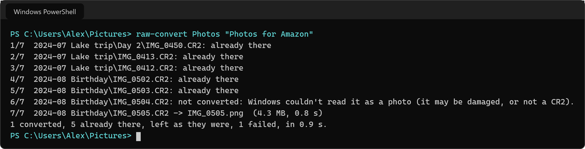

<p align="center">
  <a href="https://strongthium.com" title="Strongthium Labs"></a>
</p>

[raw-convert](../README.md) › [Manual](README.md) › Running it again

# Running it again



```
raw-convert Photos "Photos for Amazon"
```

The same command again, after two photos were added to `2024-08 Birthday`: the five photos converted before are left
as they are, the new `IMG_0505.CR2` is converted, and `IMG_0504.CR2`, which is damaged, can't be read.

## What's there already is left as it is

A photo whose PNG (or TIFF) is already in the output folder, under the name it would get, isn't converted again:

```
1/7  2024-07 Lake trip\Day 2\IMG_0450.CR2: already there
```

So running it again after adding photos, or after stopping it, converts only what's left, and the last line says how
many were left as they were. It goes by the name alone: a CR2 changed since it was converted isn't converted again
unless `--overwrite` is given. With `--copy-others`, a file already copied is left as it is the same way.

## `--overwrite`

```
raw-convert Photos "Photos for Amazon" --overwrite
```

Converts every photo again (and with `--copy-others`, copies every other file again), each in the place of the one
that's there.

## Stopping it: Ctrl+C

| | |
|---|---|
| **Ctrl+C** once | it says **Stopping once the photos being converted are done (Ctrl+C again stops at once)...**, starts no more, and finishes the photos it's converting. The last line ends **stopped before the end**, and the exit code is 1 |
| **Ctrl+C** twice | it stops at once, in the middle of whatever it was writing |

Either way, running the same command again picks up where it stopped.

## A file half written is never taken for a whole one

A photo is written beside its final name first, as `IMG_0412.png.partial`, and given its final name once it's whole.
If it stops at once, or the PC goes off, what was being written is left as a `.partial` file, which isn't taken for
the photo: the next run converts that photo again and writes over it. `.partial` files left behind can be deleted.

## A file that can't be read

```
6/7  2024-08 Birthday\IMG_0504.CR2: not converted: Windows couldn't read it as a photo (it may be damaged, or not a CR2).
```

A photo that can't be converted (or with `--copy-others`, a file that can't be copied) says why on a line of its own,
the rest go on, and the last line says how many failed. No file is left in the output folder for it, so the next run
tries it again. The exit code is then 1. What each reason means is in [Messages and exit codes](messages.md).

← [Converting a folder](converting.md) · [Contents](README.md) · [PNG or TIFF](png-or-tiff.md) →

<!-- strongthium-links -->

---

<p align="center"><sub>
<b>Strongthium open-source tools:</b> <a href="https://github.com/strongthium/emudhra-security-patch">eMudhra Security Patch</a> · <a href="https://github.com/strongthium/folder-size">Folder Size</a> · <a href="https://github.com/strongthium/health-reminder">Health Reminder</a> · <a href="https://github.com/strongthium/host-dossier">Host Dossier</a> · <a href="https://github.com/strongthium/outbound-watch">Outbound Watch</a> · <b>RAW Convert</b> · <a href="https://github.com/strongthium/video-dispatch">Video Dispatch</a> · <a href="https://github.com/strongthium/webdav-server">WebDAV Server</a><br>
<b>More from Strongthium:</b> <a href="https://strongthium.com/linux-server-firewall">Guard</a> · <a href="https://strongthium.com/self-hosted-mail-server">Mail</a> · <a href="https://strongthium.com/self-hosted-live-chat">Chat</a> · <a href="https://strongthium.com/windows-ssh-client">Remote</a> · <a href="https://strongthium.com/twilio-sms-desktop-app">SMS</a> · <a href="https://strongthium.com/time-tracking-invoicing-software">Work</a> · <a href="https://strongthium.com/windows-registry-editor">Registry</a> · <a href="https://strongthium.com/cfml-server">DotCF</a> · <a href="https://strongthium.com/video-conferencing-dial-up-modem">Convey</a><br>
<a href="https://strongthium.com">Strongthium Labs</a> · Take back control of your internet.
</sub></p>
